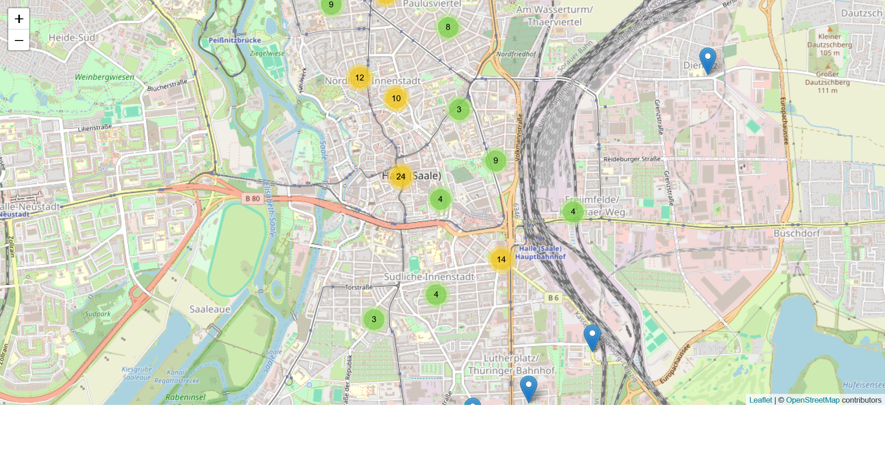

# Stolpersteinkarte
Creates a map of a city highlighting its Stolpersteine based on the wikipedia list. This code was created for the city "Halle (Saale)" and must be adapted in the indicated lines for other places.

Click on the image to open an interactive map that shows the results of the code for Halle

